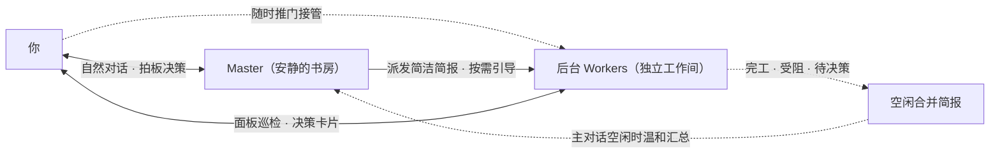

<div align="center">

# DeepDuet

**单一心智，多座工作间 · 为 DeepSeek Harness 打造的极简多会话协作模式**

[](https://deepseek-harness.github.io/deepseek-harness/reference/)
[](https://nodejs.org/)
[](./package.json)

</div>

---

大多数多智能体工具把并发复杂度直接摊在界面上：开十个窗口、反复解释上下文、来回复制粘贴、紧盯进度条——人成了调度员和监工。

**DeepDuet 反其道而行。** 它在 DeepSeek Harness（DSH）中引入与 **Standard** 并列的 **DeepDuet** 模式，把交互还原成最自然的协作直觉：

- **前台是唯一的默契搭档（Master）**：你始终只和一位连贯、记得住偏好的对话者交流。快问快答与轻量修改当场解决，绝不为了“多智能体仪式感”拖慢对话。
- **后台是安静生长的工作间（Worker）**：遇到多步实现、长耗时构建测试或并行任务，Master 自动开辟独立工作间在后台推进；一切试错噪声留在工作间内，只在收工、受阻或需要拍板时，才在主对话空闲间隙递上一份高纯度简报。
- **随时推门接管，系统无缝礼让**：在 DSH 侧边栏或右侧编排面板中，后台工作间的状态一览无余。你可以随时点进任意 Worker 直接对话接管，DeepDuet 不会抢方向盘，离开后又能自然接续。

---

## 核心特性

- **近处顺手办，远处分身跑**：查资料、改几行代码等轻量请求在主对话立刻完成；多步开发、长耗时验证与多线并行任务自动交由后台 Worker 推进。
- **静默推进，高纯度汇总**：后台探索与试错过程不往主对话刷屏；多个任务的结果会在主对话空闲时合并成一条简报递出，需要你拍板的问题自动置顶。
- **把分叉口翻译成人话**：遇到目标歧义或高风险操作时，Worker 会礼貌暂停；Master 先消化来龙去脉，用清晰选项和推荐建议向你确认，你只需回一句或点一下就能恢复推进。
- **全局余光常在，随时推门接管**：通过侧边栏状态徽标、顶部导航胶囊与右侧 **DeepDuet 编排面板**，全局进度一眼可见；随时可以切入任意 Worker 亲自指导，退出后 Master 自动同步现场状态。
- **独立工作树与原生安全边界**：并发改动同一仓库时可按需隔离到独立的 Git Worktree，互不冲突；所有后台 Worker 严格继承主会话的沙箱与权限审批策略，同时完整保留提示词前缀缓存效率。

---

## 协作流程



1. **轻量直通，重活异步派发**：Master 记住你的偏好与项目背景，只把与任务相关的目标、范围和验收标准浓缩进工作间简报，不让无关闲聊干扰执行。
2. **后台专注，不打断你的思路**：多个 Worker 在各自空间（共享目录或独立 Git Worktree）并行推进，结果自动持久化到工程账本，重启也不丢失上下文。
3. **集中决策，随手收尾**：任务完成或遇卡点时统一汇报；确认无误后，归档任务或一键清理已完成的工作树，让工作台始终保持清爽。

---

## 快速开始

### 环境要求

- **DeepSeek Harness**：`>=0.2.2-rc.2 <0.3.0-0`
- **Node.js**：`>=24.9.0`

### 构建与安装

```sh
npm install
npm run build
npm run typecheck && npm test
```

打包并安装到 DSH Profile（例如 `web`）：

```sh
npm pack
dsh plugin --profile web add "file:$PWD/dsh-plugin-deepduet-1.0.0.tgz"
```

在目标项目目录下启动 DSH Web，新建或切换会话模式时选择 **DeepDuet** 即可开始：

```sh
cd /path/to/your/project
dsh web
```

任务账本默认保存在项目根目录 `.dsh/deepduet-ledger.json`。如需显式指定工程根目录，可在 Profile 补丁中配置：

```yaml
- id: deepduet
  config:
    projectRoot: /path/to/your/project
```

---

## 延伸阅读

- [设计哲学：单一心智，多座工作间](./ideas/design-philosophy.md) —— 交互理念与七条直觉法则
- [合规实现规范 (Argon v2)](./ideas/argon_v2.md) —— 协议边界、状态机与 DSH 运行时机制
- [代码库架构与契约设计](./docs/codebase.md) —— 目录结构、模块职责与接口契约

<details>
<summary>当前版本已知边界</summary>

- **单进程账本写入**：任务账本由当前宿主进程串行原子落盘，暂不协调多个独立进程同时写入同一项目的 `.dsh/deepduet-ledger.json`。
- **异常重启恢复**：已完成的 Worker 结果会在通知前先落盘；若宿主进程意外中断，残留的运行中任务会在重启后标记为失败，可通过面板或让 Master 重新检查后恢复。
- **显式分支合并**：清理已隔离的工作树目录时会保留对应分支，分支的最终合并或删除由你或 Master 显式决定。

</details>
