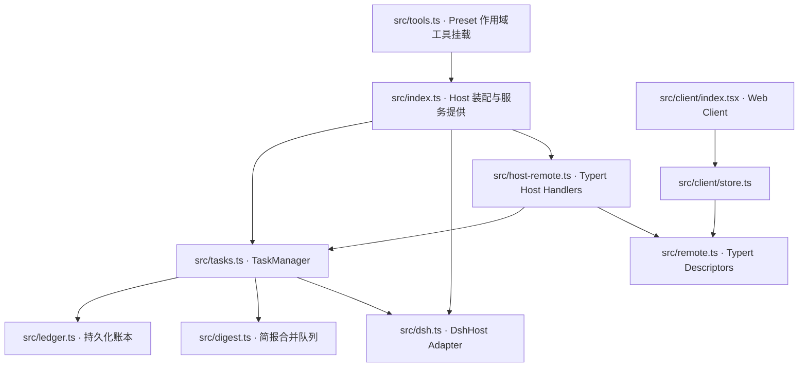

# DeepDuet Codebase Design

基于 [Argon v2](../ideas/argon_v2.md) 与 [DeepSeek Harness Reference](https://deepseek-harness.github.io/deepseek-harness/reference/)，将当前仓库实现为符合 DSH 树外 Bundle 规范的完整插件包 `dsh-plugin-deepduet`。支持轻任务直通、后台 Worker 异步并发、主动合并简报、`[NEED_DECISION]` 提问后续接、受沙箱保护的按需 Git Worktree、原生会话随时接管，以及原生 Web GUI 编排面板。

## 1. 设计重心

把“后台任务编排”做成深模块（Deep Module）：调用者（无论是模型通过 `session_*` 工具调用，还是 Web GUI 通过 Typert RPC 调用）只需执行启动、续接、查看、管理四个原语，模块内部承担会话创建、Preset 隔离、受管回合事件跟踪、账本原子持久化、结果提取与空闲门禁通知。

- **Depth**：四个核心操作覆盖完整任务生命周期，调用者无需感知底层 `session/event` 序列或防抖定时器。
- **Locality**：任务状态转移与 Worktree 生命周期集中在 [`src/tasks.ts`](../src/tasks.ts)；DSH 宿主 SDK 交互集中在 [`src/dsh.ts`](../src/dsh.ts)。
- **Leverage**：模型工具（`session_spawn / steer / inspect / manage`）、Typert 远程方法（`deepduet/*`）与集成测试共享同一个 `TaskManager` 接口。
- **Seam**：以 `DshHost`（[`src/dsh.ts`](../src/dsh.ts)）作为宿主适配边界。生产环境使用真实 DSH 服务（`agents`、`sessions`、`sessionPersistence`、`sandbox`、`sandboxPolicy`、`approval`、`workspaceRegistry`）；单元测试可使用可控的 [`tests/support/fake-host.js`](../tests/support/fake-host.js)，集成测试则直接挂载 `@deepseek-ai/dsh-agent-loop-testkit`。

## 2. 目录结构

```text
deep-duet/
├── package.json                  # dsh-plugin-deepduet 清单 (bundle.patch / agentPreset.patch / client)
├── cordis.patch.yml              # 宿主插件声明补丁
├── presets/
│   └── deepduet.patch.yml        # DeepDuet Agent Preset 声明 (order: 2)
├── tsconfig.json                 # Host 端 TypeScript 配置
├── tsconfig.client.json          # Web Client 端 TypeScript 配置
├── scripts/
│   └── build-client.mjs          # Web Client UMD/ModuleLoader 构建脚本 (输出 dist/client.js)
├── src/
│   ├── index.ts                  # Host 插件入口、DeepDuetService、Master 工具定义与 Typert 注册
│   ├── tools.ts                  # Preset 作用域插件 (dsh-plugin-deepduet/tools)
│   ├── tasks.ts                  # 后台任务核心模块：生命周期、状态机与 Worktree 管理
│   ├── dsh.ts                    # DSH 宿主适配层：Worker 创建/恢复、Turn 事件追踪、沙箱 Git、Digest 投递
│   ├── ledger.ts                 # 持久化账本模块 (.dsh/deepduet-ledger.json)：原子落盘与启动对账
│   ├── digest.ts                 # 简报队列模块：按 Master 分桶、同任务去重、优先级排序、1.5s 合并投递
│   ├── remote.ts                 # Typert 远程协议契约定义 (Zod schemas + invocation descriptors)
│   ├── host-remote.ts            # Host 端 Typert RPC 与实时 Watch 流实现
│   └── client/
│       ├── index.tsx             # Web Client 插件入口：通过 ctx.slots.inject 挂载 UI 插槽与右侧栏 Tab
│       ├── store.ts              # 基于 @deepseek-ai/dsh-client-store 的客户端状态与 $stream 订阅
│       ├── DeepDuetSidebarTab.tsx# 右侧栏 DeepDuet 编排面板组件
│       ├── DeepDuetSurface.tsx   # 会话列表徽标、Header 导航胶囊、Input Dock 决策卡与工具卡片组件
│       ├── status.ts             # 状态视图映射与计数汇总纯函数
│       └── locales.ts            # 中英文国际化词典 (namespace: 'deepduet')
└── tests/
    ├── ledger.test.js            # 账本并发写入、快照隔离与启动对账测试
    ├── digest.test.js            # 简报合并、按 Master 路由、撤回与重试测试
    ├── tasks.test.js             # 任务核心闭环、故障恢复与真实 Git Worktree 测试
    ├── dsh.test.js               # 真实 DSH Agent Loop、原生审批、接管隔离与卸载测试
    ├── gui-remote.test.js        # Typert RPC/Watch 流、Preset 隔离与 dist/client.js 插槽加载测试
    └── deepduet-mode.test.js     # Bundle 规范、Preset 作用域与 Workspace 挂载测试
```

## 3. Module 分工与依赖



| Module | Interface 与责任 | 内部隐藏的 Implementation |
| --- | --- | --- |
| [`src/tasks.ts`](../src/tasks.ts) | `spawn / steer / inspect / manage / listTasks / listAllTasks / isWorker / close` | 任务归属校验、运行排他令牌、取消与过期结果拦截、`[NEED_DECISION]` 解析、Worktree 创建与安全清理、账本更新、简报入队与撤回 |
| [`src/dsh.ts`](../src/dsh.ts) | `createWorker / runTurn / isBusy / releaseWorker / withIdleWorker / readSession / runGit / deliverDigest / close` | `SessionId` 品牌化、Worker `standard` 预设隔离、沙箱策略与审批策略继承、`session/event` 回合边界追踪、只读持久化打开、沙箱受限 Git 执行、零异步间隙 Digest 投递 |
| [`src/ledger.ts`](../src/ledger.ts) | `openLedger(projectRoot)` -> `get / list / put / close` | JSON 结构校验、Promise 链串行化写入、临时文件 + `rename` 原子替换、深拷贝快照隔离、重启遗留 `running -> failed` 对账 |
| [`src/digest.ts`](../src/digest.ts) | `createDigestQueue(deliver, warn)` -> `enqueue / forget / close` | 按 `masterId` 独立建桶、同任务最新事件覆盖、`needsDecision` 置顶排序、1.5 秒合并窗口、投递失败指数退避重试 |
| [`src/index.ts`](../src/index.ts) & [`src/tools.ts`](../src/tools.ts) | Host 插件入口与 `deepduet` Preset 工具入口 | `defineTool` 声明（含 `output`、`presentCall`、`presentResult`、`isConcurrencySafe`）、`when` 条件门禁、静态 `systemPrompt.section`、Typert 契约注册 |
| [`src/client/*`](../src/client/index.tsx) | DSH Web Client 界面扩展 | 通过 `ctx.slots.inject` 绑定插槽生命周期、通过注册项 `inject` 提供 `hooks.deepduet`（由 Renderer 合成 `useDeepduet` Hook）与预绑定动作、右侧栏 Tab 与上下文菜单 |

## 4. 任务 Interface 与错误契约

保留 Argon v2 的四个模型编排工具。工具内部从 `ToolRunContext` 获取调用方 `agent`（缺失时抛出 `ToolContextUnavailableError`），模型不能伪造 `masterId`：

```typescript
export type TaskContext = {
  masterId: string
  cwd: string
}

export type SpawnInput = {
  title: string
  prompt: string
  cwd?: string
  isolateWorktree?: boolean
}

export type SteerInput = { sessionId: string; instruction: string }
export type InspectInput = { sessionId?: string; tailMessages?: number }
export type ManageInput = {
  sessionId: string
  action: 'stop' | 'archive' | 'remove_worktree'
}
```

| 操作 | 用户与模型可观察到的结果 | 合规行为约定 |
| --- | --- | --- |
| `session_spawn` | 返回 `{ sessionId, title, cwd, status: 'running', worktree? }` | 等待 Worker 会话创建与账本落盘后立即返回，不阻塞 Master 当前回合；Worker 强制挂载 `standard` 预设以避免递归暴露编排工具 |
| `session_steer` | 返回 `{ sessionId, status: 'running' }` | 仅允许操作当前 Master 名下处于 `idle` 或 `failed` 的 Worker；忙碌时抛出 `TASK_BUSY` |
| `session_inspect` | 无 `sessionId` 返回活跃任务列表；有 `sessionId` 返回任务详情、最近消息与 Git 状态 | 标记 `isConcurrencySafe: () => true`；未加载的冷会话通过 `ctx.sessionPersistence.open(id, 'read')` 读取，不触发内存恢复 |
| `session_manage(stop)` | 返回 `{ sessionId, status: 'idle' }` | 若消息尚未被认领则从 `agent.inbox` 移除；若正在运行受管回合则调用 `agent.cancel({ kind: 'parent' }, { keepInbox: true })`，绝不销毁底层 Agent 实例 |
| `session_manage(archive)` | 返回 `{ sessionId, status: 'completed' }` | 仅归档非运行任务并释放空闲内存 Handle，底层持久化会话与工作目录文件完整保留 |
| `session_manage(remove_worktree)` | 返回 `{ sessionId, status: 'completed', removedWorktree: true }` | 通过 `agent.runMaintenance` 确保无并发回合或排队消息，仅清理插件创建的干净 Worktree，随后自动归档任务 |

## 5. 状态持久化与 DSH 合规边界

1. **账本位置**：固定保存在项目根目录 `.dsh/deepduet-ledger.json`（格式版本 `version: 1`），不随 Worker 的子目录或 Worktree 变化而漂移。
2. **预设与权限继承**：
   - 当宿主启用 `agentPresets` 且 Master 运行在 `deepduet` 预设时，`createWorker` 自动将 Worker 设为 `standard` 预设，使其作为标准编码会话运行，支持冷恢复与 Web GUI 直接接管。
   - Worker 创建时在 `setup` 中显式继承父会话的 `sandboxMode`（`setSandboxMode`）与 `approvalPolicy`（`setApprovalPolicy`）。
3. **沙箱受限 Git**：所有 Git 子进程调用前均解析 Master 会话的 `sandboxPolicy`，在非 `danger-full-access` 模式下通过 `ctx.sandbox.confine` 包装命令参数，并剥离 `GIT_DIR` / `GIT_WORK_TREE` 等局部环境变量，注入 `GIT_TERMINAL_PROMPT=0` 防止后台阻塞。
4. **Web Client 插槽合规**：
   - 客户端打包为无副作用覆盖的独立扩展 `dist/client.js`，绝不在 `cordis.patch.yml` 中重挂载 `web-runtime` 或宿主内建 UI 包。
   - 所有跨包插槽注册均通过 `ctx.slots.inject(slotName, () => ctx.slots.register(...))` 跟随声明生命周期，并通过 `locale: 'deepduet'` 与 `inject: () => ({ hooks: { deepduet: store.snapshot }, ... })` 接入 Renderer 的标准 Hook 与多语言体系。
