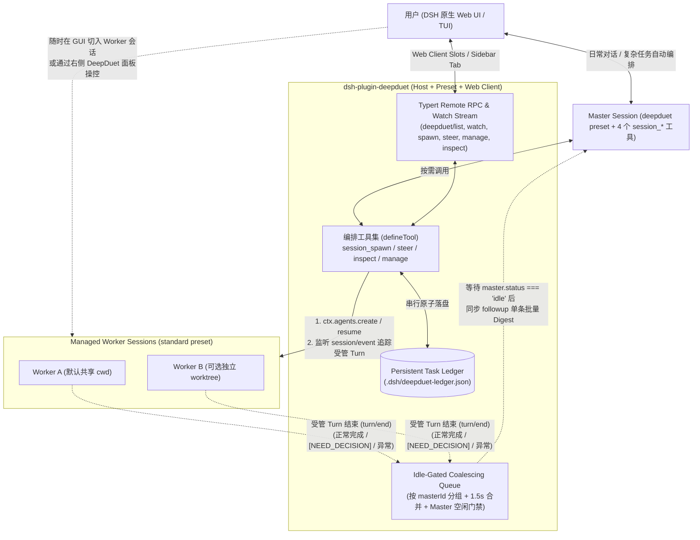
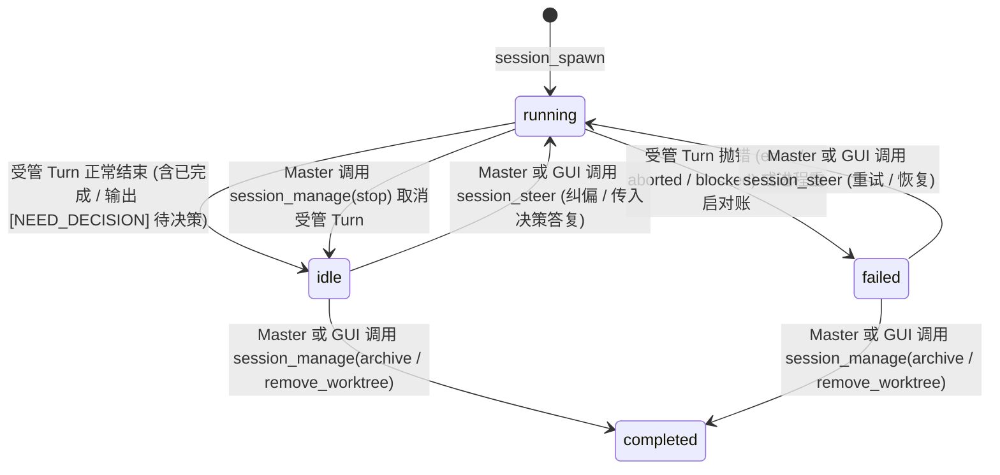

# DeepSeek Harness (DSH) DeepDuet 多会话协作插件：合规实现规范 (Argon v2)

> **状态**：v2.1 合规版（严格对齐 [DeepSeek Harness Reference](https://deepseek-harness.github.io/deepseek-harness/reference/) 规范，保全 Prompt Cache 命中率、消除跨会话死锁隐患）  
> **目标包名**：`dsh-plugin-deepduet`（遵循 DSH 树外 Bundle 命名与 `dsh.bundle.patch` / `dsh.agentPreset.patch` / `dsh.client` 规范）  
> **核心特征**：**不造新会话状态、不破前缀 KV Cache、不搞双倍传话税、100% 遵循 DSH 宿主契约**

---

## 1. v2 精简与合规核心原则（Why Less is More）

相比 v1.0，v2 遵循**「不造新状态、不破 Prompt Cache、不搞双倍传话税」**三大原则，并严格对齐 DSH 官方子系统契约：

| 维度 | v1.0 复杂设计（已废弃） | v2 合规极简方案（当前锁定） | 收益 |
| :--- | :--- | :--- | :--- |
| **审批与追问 (Approval)** | 内存未决 Promise 挂起 + `ask_human` + `session_approve` + `waiting_approval` 状态 | **自然回合结束 (`idle`) + 结构化标记 + 原生审批直通**：Worker 遇业务歧义或高风险计划停下并在回复末尾输出 `[NEED_DECISION]: <question>`，自然结束当前 Turn 进入 `idle`；工具级权限审批继续复用 DSH 原生 `@deepseek-ai/dsh-user-approval`（继承父会话策略）。 | 省去跨会话悬空 Promise 注册表；不绕过原生工具审批管线；每次确认省去 1~2 轮主从传话调用。 |
| **主从职责与工具边界** | 运行时硬裁剪（`currentInitiator` 拦截，严禁 Master 写文件/跑命令） | **Preset 作用域隔离 + `when` 条件激活 + 轻量直通**：通过 `presets/deepduet.patch.yml` 为 `deepduet` 模式挂载 Master 编排工具（附带 `{ when: ({ agent }) => isMaster(agent) }`）；Worker 固定使用 `standard` 预设，天然不暴露 `session_*` 编排工具。 | 彻底消除微小任务的“拉起冷启动 Worker + 汇总”双倍 Token 税与 15 秒延迟，且杜绝 Worker 递归派生。 |
| **长上下文与账本同步** | 每轮动态注入账本至 System Prompt + 插件自建主会话滚动摘要压缩器 | **静态 Prompt Section 保缓存 + 按需读取账本**：通过 `ctx.systemPrompt.section({ name, order: 3100, text, interpolate: false })` 贡献固定字节文本；账本仅通过后台 Digest 消息或 `session_inspect` 工具按需带入；长上下文直接复用 DSH 原生 `/compact`。 | **100% 保住 Master 与 Worker 的 Prefix KV Cache 命中率**，符合 `dsh-system-prompt` 静态段落规范。 |
| **工作区隔离与沙箱 (Sandbox & Worktree)** | 插件无视沙箱直接跑 Git 创建/自动 `merge`、冲突处理与 `discard` 状态机 | **遵循 `sandboxPolicy` 与 `sandbox.confine`**：先校验 `workspaceWritableRoots(policy)`，Git 命令统一通过 `ctx.sandbox.confine(command, policy, signal)` 封装并注入防挂起环境变量；`session_spawn` 仅支持可选 `isolateWorktree: boolean`（创建 `deepduet/<id>` 分支与 `.dsh/worktrees/<id>`）。 | 严格遵守 DSH 沙箱边界与可写根目录约束，砍掉脆弱的自动合并脚本。 |
| **手动接管防打扰 (Takeover)** | 全局监听消息来源钩子，维护 `lastInitiator: 'master' \| 'user_takeover'` 状态翻转 | **基于 `session/event` 的受管 Turn 精确追踪**：提交 `createUserMessage` 后按 `message.id` 匹配 `user/message` 入列事件与对应 `turn/start`、`assistant/message`、`turn/end`；用户在 GUI 直接向 Worker 发送原生消息拥有不同 `message.id`，天然不会触发 Master 回调。 | 精确识别 `completed` / `max-tokens` / `aborted` / `error` / `blocked` 等全部 `TurnEndReason`，完美支持 GUI 随时接管。 |

---

## 2. 系统架构与状态流转设计

### 2.1 整体架构图



### 2.2 极简 Worker 状态机（仅 4 个状态）

砍掉 `waiting_approval` 与冗余中间态，所有“等待人工决策”本质上都是携带 `needsDecision: true` 与 `decisionQuestion` 的 `idle` 状态：



---

## 3. 核心数据结构与工具定义

### 3.1 持久化任务账本（`.dsh/deepduet-ledger.json`）

遵循原子写入（临时文件 + `rename`）与快照拷贝返回，同时独立保存 `masterId` 与未截断的 `decisionQuestion`：

```typescript
export type WorkerStatus = 'running' | 'idle' | 'failed' | 'completed'

export interface WorktreeInfo {
  repoRoot: string
  path: string
  branch: string
}

export interface TaskRecord {
  masterId: string             // 所属 Master SessionId，用于多会话隔离与 Digest 路由
  sessionId: string            // Worker SessionId
  title: string
  goal: string
  cwd: string
  worktree?: WorktreeInfo      // 若启用了 isolateWorktree 则记录仓库根、路径与分支名
  status: WorkerStatus
  needsDecision: boolean       // Worker 回复末尾是否包含 [NEED_DECISION]: <question>
  decisionQuestion?: string    // 完整保留待拍板问题，不受摘要 500 字截断影响
  lastSummary?: string         // 最近一次受管回合的摘要（截断至 500 字）
  createdAt: number
  updatedAt: number
}
```

### 3.2 合规的 4 个编排工具（`defineTool`）

所有工具均通过 `@deepseek-ai/dsh-tools` 的 `defineTool` 定义，声明 `output: { schema, render }`、`presentCall` / `presentResult`，并通过 `{ when: ({ agent }) => isMaster(agent) }` 限制仅向主会话暴露；业务错误统一映射为携带稳定 `code` 的 `HarnessError`（缺失调用 Agent 时抛出 `ToolContextUnavailableError`）：

| 工具名 | 参数 Schema | 核心合规实现逻辑 |
| :--- | :--- | :--- |
| `session_spawn` | `{ title: string, prompt: string, cwd?: string, isolateWorktree?: boolean }` | 1. 校验目标 `cwd` 是否在 Master 会话 `sandboxPolicy` 允许的 `workspaceWritableRoots` 内。<br>2. 若 `isolateWorktree` 为真，通过沙箱受限的 `runGit` 执行 `git worktree add -b deepduet/<id> .dsh/worktrees/<id> HEAD`。<br>3. 调用 `ctx.agents.create({ sessionId, meta: { cwd, parentSession: parent.id, agentPreset: 'standard' }, agentOptions, setup })`，在 `setup` 中挂载 `standard` 预设并同步 `setSandboxMode` 与 `setApprovalPolicy`，同时关联 `workspaceRegistry`。<br>4. 写入账本（`status: 'running'`），后台启动 `runTurn`，立即返回任务凭据。 |
| `session_steer` | `{ sessionId: string, instruction: string }` | 1. 校验任务归属当前 `masterId` 且状态非 `running` / `completed`，撤回 `digest.forget(masterId, sessionId)` 中未发送的旧简报。<br>2. 若目标 Worker 会话未加载，通过 `ctx.agents.resume({ resumeSessionId, signal, setup })` 恢复并挂载对应预设。<br>3. 更新账本 `status = 'running'`、`needsDecision = false`，后台启动 `runTurn(sessionId, instruction, signal)`。 |
| `session_inspect` | `{ sessionId?: string, tailMessages?: number }` | 标记 `isConcurrencySafe: () => true`。<br>1. 不传 `sessionId`：返回当前 `masterId` 下所有非 `completed` 任务快照。<br>2. 传入 `sessionId`：若会话在内存则读取 `agent.session.deriveMessages()`，若已卸载则通过 `ctx.sessionPersistence.open(id, 'read')` 只读打开事件流（不触发 `resume` 唤醒内存实例），并附带沙箱受限的 `git status --short`。 |
| `session_manage` | `{ sessionId: string, action: 'stop' \| 'archive' \| 'remove_worktree' }` | 1. `stop`：中断当前受管 Turn 的 `AbortController`；在 `dsh.ts` 中若消息尚未被认领则调用 `agent.inbox.remove(message.id)`，若正在执行该受管 Turn 则调用 `agent.cancel({ kind: 'parent' }, { keepInbox: true })`（**绝不**调用 `handle.dispose()` 销毁会话），账本置为 `idle`。<br>2. `archive`：仅对空闲/失败且无原生排队消息的 Worker 置为 `completed` 并释放空闲 Handle。<br>3. `remove_worktree`：通过 `agent.runMaintenance` 锁定空闲 Worker，校验无未提交脏文件后执行 `git worktree remove`，将任务归档为 `completed`。 |

---

## 4. 关键 DSH 合规运行时机制实现

### 4.1 自定义消息源声明合并与受管 Turn 追踪（`dsh.ts`）

按照 `@deepseek-ai/dsh-llm` 与 `@deepseek-ai/dsh-agent` 规范：
1. `agent.followup(message)` 是同步入列方法（返回 `void`），入参必须是由 `createUserMessage` 构造的 `UserMessage`，且自定义 `source.kind` 必须通过 TypeScript 声明合并扩展 `MessageSourceMap`。
2. `agent.whenIdle()` 在回合出错或被取消时也会正常 `resolve()`（不会 `reject`），因此必须监听 `ctx.on('session/event', ...)` 匹配本次提交的 `message.id` 及其所在的 `turn` 编号，精确处理 `turn/end` 的 `reason`：

```typescript
declare module '@deepseek-ai/dsh-llm/types' {
  interface MessageSourceMap {
    deepduet:
      | { kind: 'deepduet'; form: 'notice'; summary: string }
      | { kind: 'deepduet'; form: 'assignment' }
  }
}

async function runTurn(sessionId: string, input: string, signal: AbortSignal): Promise<string> {
  signal.throwIfAborted()
  const agent = await resume(brandString<SessionId>(sessionId), signal)
  if (agent.status !== 'idle' || hasPending(agent)) {
    throw new Error(`Session ${sessionId} already has active or queued work`)
  }

  const message = createUserMessage({
    content: [{ type: 'text', text: input }],
    source: { kind: 'deepduet', form: 'assignment' },
  })
  const result = Promise.withResolvers<string>()
  let firstTurn: number | undefined
  let admitted = false
  let reply = ''

  const unsubscribe = ctx.on('session/event', (session, event) => {
    if (session !== agent.session) return
    if (event.type === 'turn/start') firstTurn ??= event.data.turn
    if (event.type === 'user/message' && event.data.id === message.id) admitted = true
    if (event.type === 'assistant/message' && admitted && event.data.turn === firstTurn) {
      const text = textOf(event.data.message)
      if (text) reply = text
    }
    if (event.type !== 'turn/end' || event.data.turn !== firstTurn) return
    const reason = event.data.reason
    if (admitted && (reason.kind === 'completed' || reason.kind === 'max-tokens')) {
      result.resolve(reply)
    } else {
      result.reject(new Error(reason.kind === 'error' ? reason.error.message : `Worker turn ended: ${reason.kind}`))
    }
  })

  try {
    agent.followup(message)
    // ... 等待 result.promise 或 signal.abort，并在取消时使用 agent.inbox.remove / agent.cancel({ kind: 'parent' }, { keepInbox: true })
    return await result.promise
  } finally {
    unsubscribe()
  }
}
```

### 4.2 按 Master 分组的 Idle-Gated 1.5s 防抖合并唤醒队列（`digest.ts` & `dsh.ts`）

1. **按 `masterId` 独立建桶**：避免多主会话并发时不同 Master 的后台通知互相串扰。
2. **首次事件定窗（1.5s）**：窗口内同 `sessionId` 事件覆盖旧值，按 `needsDecision` 置顶排序。
3. **零异步间隙投递**：在 `deliverDigest` 中循环等待 `while (master.status !== 'idle')`，一旦确认 `master.status === 'idle'`，**同步**取出批次并调用 `master.followup(createUserMessage(...))`，中间绝不插入任何 `await`，彻底杜绝竞态打断：

```typescript
async function deliverDigest(
  id: string,
  takeMessage: () => string | undefined,
  signal: AbortSignal,
) {
  const master = await resume(brandString<SessionId>(id), signal)
  do {
    await waitForIdle(master, signal)
    signal.throwIfAborted()
  } while (master.status !== 'idle')

  // 在最后一次 idle 检查与 followup 入列之间没有任何 await
  const text = takeMessage()
  if (text === undefined) return
  master.followup(createUserMessage({
    content: [{ type: 'text', text }],
    source: { kind: 'deepduet', form: 'notice', summary: 'Background worker updates' },
  }))
}
```

### 4.3 静态 System Prompt Section（100% 保护前缀缓存）

通过 `ctx.systemPrompt.section` 注入 `interpolate: false` 的静态段落（`order: 3100`），仅根据当前 `agent` 角色决定返回固定字符串或空串 `''`：

* **Master 提示词片段（`deepduet`）**：
  围绕 DeepDuet 架构能力划分为 5 个结构化模块（完全静态字符串，`interpolate: false`）：
  1. **Execution Routing (Direct Tools vs. Background Workers)**：10 秒内的轻量查询、小改与短命令直接使用原生工具；多步实现、长耗时构建/测试与并行工作流通过 `session_spawn` 拉起持久化 Worker。
  2. **Self-Contained Worker Briefs & Worktree Isolation (`session_spawn`)**：明确 Worker 处于独立 `standard` 预设且不共享 Master 历史，要求 `prompt` 包含自包含的 Goal & Context、Scope Boundaries 与 Verification Criteria；并发修改同一仓库或高风险重构开启 `isolateWorktree: true`（`.dsh/worktrees/<sessionId>` / `deepduet/<sessionId>`）。
  3. **Non-Blocking Turn Discipline & Reactive `[Background Digest]`**：对齐 Idle-Gated 1.5s 合并唤醒机制，要求派发或续接 Worker 后立即向用户说明进展并结束当前 Turn（禁止轮询 `session_inspect`），以便 `master.status === 'idle'` 时投递 `[Background Digest]`；注意摘要 500 字截断并按需通过 `session_inspect` 读取详情。
  4. **Steering, `[NEED_DECISION]` Relay & Failure Recovery (`session_steer`)**：利用 Worker 跨轮次保留上下文的特性发送增量指令；遇 `[NEED_DECISION]` 先向用户提问确认再通过 `session_steer` 传回答复；支持对 `failed`（含重启对账）任务进行诊断恢复。
  5. **Inspection, GUI Takeover Coexistence & Lifecycle Hygiene (`session_inspect`, `session_manage`)**：感知用户在原生 GUI 的手动接管（不触发 Digest、忙碌时返回 `TASK_BUSY`），通过 `session_inspect` 同步状态与 `git status --short`；将 Worker 结果视为待验证报告，完成集成后通过 `session_manage(stop | archive | remove_worktree)` 维护账本与干净 Worktree 的生命周期。
* **Worker 提示词片段（`deepduet-worker`）**：
  > You are a DeepDuet background worker. Focus on your assigned goal and end with a short summary of changes and verification.
  > If an operation is destructive or the requirements are materially ambiguous, stop before acting. End your reply with a separate line in the form `[NEED_DECISION]: <specific question and options>`. Continue when the Master sends the user's decision.

---

## 5. 树外插件 Bundle 结构与 Web Client 扩展

遵循 [Adding a Package](https://deepseek-harness.github.io/deepseek-harness/reference/cookbook/adding-a-package) 与 [Extension Cookbook](https://deepseek-harness.github.io/deepseek-harness/reference/cookbook/extension-cookbook)，仓库根目录即为树外插件包 `dsh-plugin-deepduet`：

```text
dsh-plugin-deepduet/
├── package.json              # 声明 dsh.bundle.patch、dsh.agentPreset.patch、dsh.client 与 engines.dsh
├── cordis.patch.yml          # 向宿主注入 dsh-plugin-deepduet 服务
├── presets/
│   └── deepduet.patch.yml    # 注册 deepduet 模式预设 (order: 2)，挂载 dsh-plugin-deepduet/tools
├── src/
│   ├── index.ts              # Host 插件入口、Service 暴露、Typert 注册与 Master 工具定义
│   ├── tools.ts              # Preset 子插件入口 (dsh-plugin-deepduet/tools)，在 Preset 作用域挂载 Master 工具
│   ├── tasks.ts              # 任务生命周期核心状态机与 Worktree 管理
│   ├── dsh.ts                # DSH Host Adapter (agents / sessions / sandbox / persistence / digest 投递)
│   ├── ledger.ts             # .dsh/deepduet-ledger.json 串行原子持久化与启动对账
│   ├── digest.ts             # 按 Master 分组的 1.5s 合并防抖队列
│   ├── remote.ts             # Typert RPC 与 Stream 契约 (deepduet/list, watch, spawn, steer, manage, inspect)
│   ├── host-remote.ts        # Host 侧 Typert 方法实现与实时快照推送
│   └── client/               # Web Client 扩展 (打包为 dist/client.js，通过 ctx.slots.inject 注册 UI 插槽)
└── tests/                    # 覆盖 Ledger、Digest、Tasks、真实 Agent Loop (dsh) 与 GUI/Typert 集成测试
```
