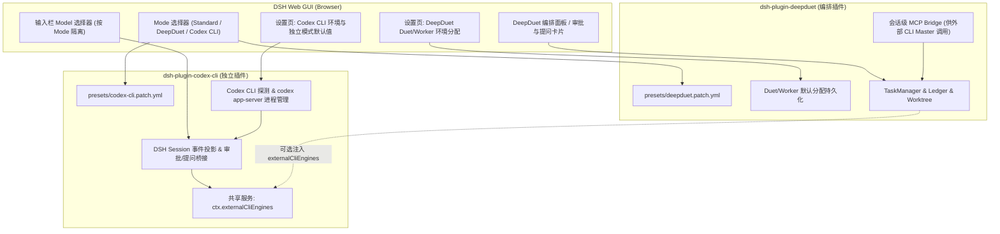
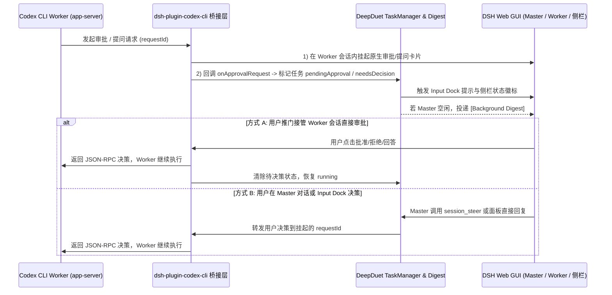

# Multi-Agent CLI Mode Support Plan (`codex-cli` & `deepduet` Integration)

## 1. 背景与核心目标

当前 `dsh-plugin-deepduet` 仅支持在 DeepSeek Harness（DSH）内置的 `ReactLoopAgent` 中运行 Master（`deepduet` preset）与后台 Worker（`standard` preset）。本次规划的目标是让 DSH 与 DeepDuet 原生接入本地外部 Agent CLI 运行时，核心约束与需求如下：

1. **真实 CLI 环境托管，而非 API 反向代理**：
   - 将本地 **Codex CLI**（通过 `codex app-server` JSON-RPC）映射为 DSH 前台 GUI 中的独立 **Mode（AgentPreset）**。
   - 对话循环、内置工具执行、沙箱隔离与命令/文件审批均在本地 Codex CLI 环境中完成，DSH 负责前台展示、会话持久化投影与交互桥接。
   - 严格依赖用户本机已安装的 `codex` CLI 与本机登录态（`codex login`），不内置捆绑二进制、不读取/复制凭据做 OAuth 反向代理。
2. **Mode 与内置 Model 严格隔离联动**：
   - 在 DSH 新建会话选择 `codex-cli` Mode 后，前台输入栏的模型选择器仅展示并默认选中 Codex CLI 发现的内置模型及对应推理强度（Reasoning Effort），不与 DSH 普通 API 模型混用。
3. **Duet 与 Worker 独立分配运行环境（Mode - Model - Reasoning Effort - Sandbox）**：
   - 在设置界面分别为 **Duet（Master）默认** 与 **Worker 默认** 分配完整的运行配置四元组：
     - 环境（Mode）：如 DSH 原生（`DeepDuet` / `Standard`）、`Codex CLI`（及预留未来的 `AGY CLI`）
     - 模型（Model）：随所选环境联动列出可用模型
     - 推理强度（Reasoning Effort）：随所选模型联动列出可用档位
     - 沙箱与审批策略（Sandbox / Approval Policy）：沿用 Codex 可选沙箱策略（`read-only` / `workspace-write` / `danger-full-access`）与审批策略
   - 支持在 Master 派发（`session_spawn`）或 GUI 右侧编排面板新建 Worker 时对单次任务的四元组按需覆盖。
4. **外部 CLI 担任 Duet Master**：
   - 新建会话直接选 `codex-cli` 为独立单会话直连 Codex CLI；选择 `DeepDuet` 时则按设置里的 **Duet 默认配置** 启动 Master，并按 **Worker 默认配置** 派发后台工作间。
   - 当 Duet（Master）本身被分配给外部 CLI 环境（如 `codex-cli` 或未来的 `agy-cli`）时，通过会话级本地 MCP Server + 指令注入把 `session_spawn` / `session_steer` / `session_inspect` / `session_manage` 暴露给外部 CLI。
5. **双插件解耦与未来 `agy-cli` 预留**：
   - 拆分为两个独立树外插件仓库：
     - `../dsh-plugin-codex-cli`（`dsh-plugin-codex-cli`）：独立提供 `codex-cli` Mode 与本地 Codex CLI 托管运行时。
     - `../deep-duet`（`dsh-plugin-deepduet`）：保持独立可用，并通过约定的 Cordis 服务契约松耦合发现外部 CLI 引擎（先 `codex-cli`，未来 `dsh-plugin-agy-cli` 实现同一契约即可无缝接入）。

---

## 2. 双插件总体架构与解耦边界



### 2.1 共享外部 CLI 引擎契约（`ctx.externalCliEngines`）

两个插件互不强依赖（`package.json` 不写硬性 `peerDependencies` 耦合），通过约定的 Cordis 服务名 `externalCliEngines` 与标准 TypeScript 结构化接口松耦合联动（类似插件可各自声明 `declare module '@deepseek-ai/cordis'`，或复用无运行时副作用的类型声明）：

```typescript
export type ExternalCliSandboxMode = 'read-only' | 'workspace-write' | 'danger-full-access'
export type ExternalCliApprovalPolicy = 'untrusted' | 'on-request' | 'never'

export interface ExternalCliModelInfo {
  id: string
  name: string
  description?: string
  reasoningEfforts?: { id: string; name: string; description?: string }[]
  defaultReasoningEffort?: string
}

export interface ExternalCliHealth {
  available: boolean
  binaryPath?: string
  version?: string
  authenticated: boolean
  accountLabel?: string
  errorCode?: 'CLI_NOT_FOUND' | 'CLI_NOT_AUTHENTICATED' | 'CLI_UNHEALTHY'
  message?: string
}

export interface ExternalCliTurnConfig {
  model?: string
  reasoningEffort?: string
  sandboxMode?: ExternalCliSandboxMode
  approvalPolicy?: ExternalCliApprovalPolicy
  /** 供外部 CLI Master 注入 DeepDuet 编排指令与本地 MCP Server */
  developerInstructions?: string
  mcpServers?: Record<string, { command: string; args: string[]; env?: Record<string, string> }>
}

export interface ExternalCliApprovalRequest {
  requestId: string
  kind: 'command' | 'file-change' | 'user-input'
  title: string
  detail: string
  options?: { id: string; label: string; description?: string }[]
  resolve: (decision: { approved: boolean; payload?: unknown }) => void
}

export interface ExternalCliEngine {
  readonly id: string            // e.g. 'codex-cli', future 'agy-cli'
  readonly presetId: string      // DSH agentPreset id, e.g. 'codex-cli'
  readonly label: string         // UI display name, e.g. 'Codex CLI'
  readonly supportedSandboxes: readonly ExternalCliSandboxMode[]
  readonly supportedApprovals: readonly ExternalCliApprovalPolicy[]

  checkHealth(forceRefresh?: boolean): Promise<ExternalCliHealth>
  listModels(forceRefresh?: boolean): Promise<ExternalCliModelInfo[]>

  /** 将一个已创建/恢复的 DSH Session 绑定到外部 CLI Thread，或配置外部 Master 注入 */
  configureSession(sessionId: string, config: ExternalCliTurnConfig): Promise<void>
  /** 执行外部 CLI 轮次并把流式事件实时投影到指定 DSH Session */
  runSessionTurn(params: {
    sessionId: string
    input: string
    config?: ExternalCliTurnConfig
    signal: AbortSignal
    onApprovalRequest?: (req: ExternalCliApprovalRequest) => void
  }): Promise<{ replyText: string; threadId: string }>
  isSessionBusy(sessionId: string): boolean
  cancelSessionTurn(sessionId: string): Promise<void>
  readSessionThreadId(sessionId: string): Promise<string | undefined>
}

export interface ExternalCliEngineRegistry {
  register(engine: ExternalCliEngine): () => void
  get(idOrPreset: string): ExternalCliEngine | undefined
  list(): ExternalCliEngine[]
  onChange(listener: () => void): () => void
}
```

- **向后兼容原则**：`dsh-plugin-codex-cli` 在自身加载时若发现宿主尚未提供 `externalCliEngines` 服务，可由自身注册轻量 `ExternalCliEngineRegistry` 服务（或由任一先加载方提供幂等容器），确保安装顺序无关。

---

## 3. 插件 A：`dsh-plugin-codex-cli` 详细设计

存放路径：`../dsh-plugin-codex-cli`（独立 npm 包、遵循 DSH Host ESM + Browser UMD `dist/client.js` 双端构建规范）。

### 3.1 目录结构规划

```text
dsh-plugin-codex-cli/
├── package.json                  # dsh-plugin-codex-cli (bundle.patch + client)
├── cordis.patch.yml              # 挂载 host 主插件
├── presets/
│   └── codex-cli.patch.yml       # 注册 preset id: 'codex-cli' (order: 3)
├── tsconfig.json
├── tsconfig.client.json
├── scripts/build-client.mjs
├── src/
│   ├── index.ts                  # Host 入口：配置、CodexCliService、Preset/Llm/Session 桥接、Typert RPC
│   ├── preset-runtime.ts         # codex-cli Preset 作用域插件：拦截并托管回合执行与事件投影
│   ├── codex-binary.ts           # 跨平台 codex CLI 路径探测、版本检查与 login 状态诊断
│   ├── codex-app-server.ts       # codex app-server JSON-RPC over stdio 客户端（并发/超时/断线清理）
│   ├── session-projector.ts      # Codex item/turn 事件 -> DSH SessionEvent & AssistantStreamFrame 映射
│   ├── model-isolation.ts        # Mode-Model 严格隔离与本地模型目录缓存
│   ├── remote.ts                 # Typert RPC 契约（健康检查、模型列表、配置、审批响应）
│   └── client/
│       ├── index.tsx             # Web Client 入口：设置页、Mode-Model 隔离渲染、状态徽标
│       ├── CodexSettingsSection.tsx # 设置页：CLI 路径、登录诊断、独立模式默认沙箱/审批/推理强度
│       ├── CodexModelControl.tsx # codex-cli Mode 下专属模型与推理档位选择器
│       └── locales.ts
└── tests/
    ├── codex-binary.test.js
    ├── app-server-rpc.test.js    # Mock JSON-RPC server 验证 thread/start, resume, interrupt, approval
    └── dsh-codex-mode.test.js    # @deepseek-ai/dsh-agent-loop-testkit 验证 preset、投影与隔离
```

### 3.2 本机 Codex CLI 环境探测与认证校验

1. **路径探测（Windows / macOS / Linux）**：
   - 优先使用设置项 `binaryPath`（非空时校验存在且可执行）。
   - 未配置时按平台扫描 `PATH`（Windows 上兼容 `codex.cmd` / `codex.exe` / npm 全局 shim，若为 `.cmd` 包装脚本则以正确子进程启动方式执行，避免 shell 拼接注入）。
2. **健康与登录检查**：
   - 启动/设置页检测时检查 `codex --version` 及登录态（通过 `codex login status` 或 `app-server` 的 `account/read` / `getAuthStatus`）。
   - 若未找到可执行文件：返回 `CLI_NOT_FOUND`，提示安装 `@openai/codex` 或配置路径。
   - 若未登录：返回 `CLI_NOT_AUTHENTICATED`，提示用户在本机终端执行 `codex login`，**绝不触发内置 OAuth 或读取/导出 token 到反向代理**。

### 3.3 `codex app-server` JSON-RPC 通信与会话映射

1. **进程管理**：
   - 维护常驻或按需拉起的 `codex app-server` 子进程（stdio JSONL JSON-RPC 2.0，带请求 ID 关联、超时取消与插件卸载 `ctx.effect` 优雅关闭）。
   - 环境变量保留用户本机的 `CODEX_HOME` / `PATH` / 代理配置，不写入明文 API Key。
2. **Thread 与 DSH Session 绑定**：
   - 每个运行 `codex-cli` Mode 的 DSH Session 绑定唯一的 `codexThreadId`。
   - **持久化事件**：在 DSH Session 中追加自定义日志事件（例如 `'codex-cli/thread': { threadId, cwd, model, reasoningEffort, sandboxMode }`），使会话关闭或 DSH 重启后仍能从 Session 日志还原 `threadId`。
   - **冷恢复**：当历史 `codex-cli` 会话再次收到消息时，向 `codex app-server` 发送 `thread/resume`（附带 `threadId`、`cwd` 与当前配置）恢复线程，若原本地线程已丢失则返回明确错误或按策略提示。

### 3.4 前台 GUI 托管执行与事件投影（避免 DSH 重复跑工具）

在 DSH SDK（`@deepseek-ai/dsh-agent-loop`）中，`ctx.agents.setFactory` 为全局单工厂注册，`dsh-api-session-controller` 通过 `ReactLoopAgent` 驱动会话回合与收尾。为遵守 DSH 规范且不修改宿主包，采用以下接管机制：

1. **Preset 作用域绑定（`presets/codex-cli.patch.yml`）**：
   - 注册 `id: 'codex-cli'`、`name: 'Codex CLI'` 的 Preset，内部挂载 `dsh-plugin-codex-cli/runtime` 作用域插件，**不挂载** DSH 原生的 `tool-bash` / `tool-fs` 等本地执行工具（避免 DSH 侧工具与 Codex CLI 工具混杂或误执行）。
2. **回合接管与事件投影**：
   - 当 `codex-cli` Preset 挂载到某个 `Agent` 上时，通过 `llm/stream`（或 `preparedCall`）接管本次请求流：
     - 将用户输入发送给 `codex app-server` 的 `turn/start`（附带 `threadId`、选择的 `model`、`effort`、`sandboxPolicy`、`approvalPolicy`）。
     - 在 Codex 执行多步推理与工具调用期间：
       - **文本与推理流**：实时转化为 DSH `StreamChunk`，通过 GUI 流式打字输出，最终结算为标准 `assistant/message`（仅含最终文本/推理块，不返回未执行的 `tool-call` 块，避免 `ReactLoopAgent` 再次触发 `tools.execute`）。
       - **工具过程投影（命令执行、文件读写/Diff、MCP/WebSearch）**：Codex CLI 内部已完成工具执行并返回 `item/started` / `item/completed`（含命令 stdout/stderr、文件 patch diff、文件路径）。将其投影为标准 DSH `tool/call` + `tool/result`（含可渲染的 `meta` diff/command 输出），或以 Codex 专属工具卡片 Slot 渲染到当前回合的 Surface 中，从而在 DSH GUI 中获得与原生一致的可折叠工具卡片与代码 Diff 视图，同时保证冷恢复后历史记录完整可看。
   - **取消协同**：当用户在 GUI 点击 Stop 或 `agent.cancel(...)` 触发时，`AbortSignal` 立即向 `codex app-server` 发送 `turn/interrupt`，优雅中断当前 Codex 回合。

### 3.5 Mode 与 Model 严格隔离机制

在原生 DSH 中，`@deepseek-ai/dsh-client-ui-model-selection` 的 `ModelSelect` 从全局 `remote.session.modelCatalog()` 读取全部 Provider，因此需要前后端联动隔离：

1. **后端（Host）隔离校验**：
   - `codex-cli` 注册内部路由标识（例如 `provider: 'codex-cli'`），其模型列表与推理强度完全由 `codex app-server` 的 `model/list` 动态发现并缓存。
   - 在 `selectModel` / `agent/request` 拦截层强校验：
     - 当 Session 的 `agentPreset === 'codex-cli'`（或 DeepDuet Session 当前绑定了 `codex-cli` 引擎）时，**只允许选择 `codex-cli` 发现的模型**，并自动将初始默认模型设为 Codex CLI 推荐/默认模型；拒绝普通 DSH 模型写入。
     - 当 Session 处于 `standard` / `deepduet` 原生模式时，不允许将其直接路由到 `codex-cli` provider（防止绕过 Mode 切换把 Codex 当成反向代理模型调用）。
2. **前端（Web GUI）输入栏与 `/model` 隔离**：
   - 通过 `ctx.remote` 暴露 `codexCli/models` 与会话级模式状态；
   - 在 `codex-cli` Mode 的会话中，接管/替换模型选择控件展示或过滤列表（如通过 `dsh-plugin-codex-cli` 在该会话下呈现只含 Codex CLI 内置模型与 Reasoning Effort 的选择器，并在切换到 `codex-cli` Mode 时自动切换触发默认选中项；非 `codex-cli` Mode 下隐藏 `codex-cli` 分组）。

### 3.6 Codex 审批、提问与沙箱策略映射

1. **配置项**：
   - **沙箱策略**：`read-only`、`workspace-write`（默认）、`danger-full-access`。
   - **审批策略**：`on-request`（按 Codex 风险策略请求确认，默认）、`untrusted`、`never`。
   - **推理强度**：动态读取所选模型支持的 `reasoningEfforts`（如 `low` / `medium` / `high` / `xhigh`）。
2. **交互桥接**：
   - 当 `codex app-server` 发出服务端请求（命令执行审批 `item/commandExecution/requestApproval`、文件变更审批 `item/fileChange/requestApproval`、交互提问 `item/tool/requestUserInput`）：
     - **前台独立会话**：直接通过 DSH 原生 `ctx.approval` / `ctx.userQuestions` 能力在当前会话界面弹出审批或提问卡片，用户点击「允许 / 拒绝 / 回答」后将结果回传给 `codex app-server` JSON-RPC 响应。

---

## 4. 插件 B：`dsh-plugin-deepduet` 联动改造设计

改造仓库：`deep-duet`（保持未安装 `dsh-plugin-codex-cli` 时 100% 兼容现有功能与测试）。

### 4.1 角色分配模型与设置持久化

在 `$DSH_HOME/deepduet/`（或宿主配置文档 `ctx.settings` + 账本配置）中持久化 DeepDuet 角色环境分配：

```typescript
export interface AgentRoleProfile {
  /** 'native' (DSH 原生 DeepDuet/Standard) 或外部引擎 ID (如 'codex-cli', 未来 'agy-cli') */
  engine: 'native' | string
  /** 对应的 DSH Mode/Preset ID（native 时 Master 为 'deepduet'、Worker 为 'standard'） */
  presetId: string
  /** 模型选择（native 时为 provider/model，外部引擎时为该引擎发现的 modelId） */
  provider?: string
  model?: string
  reasoningEffort?: string
  /** 沙箱与审批策略（外部 CLI 引擎与受管 Worker 生效） */
  sandboxMode?: 'read-only' | 'workspace-write' | 'danger-full-access'
  approvalPolicy?: 'untrusted' | 'on-request' | 'never'
}

export interface DeepDuetEngineSettings {
  master: AgentRoleProfile
  workerDefault: AgentRoleProfile
}
```

- **界面联动效果**（注册在 `settings.section`，id: `deepduet`，order 紧邻常规/Preset 设置）：
  - **Duet（Master）默认配置卡片** + **Worker 默认配置卡片**：
    - 第 1 项：**环境（Mode）**下拉框 —— 动态列出 `DSH Native` + 所有通过 `externalCliEngines` 注册的引擎（当前安装后出现 `Codex CLI`，未来安装 `dsh-plugin-agy-cli` 自动出现 `AGY CLI`）。
    - 第 2 项：**模型（Model）**下拉框 —— 随所选环境动态切换数据源（选 `DSH Native` 时读取 DSH `modelCatalog`；选 `Codex CLI` 时读取 `codex-cli` 引擎的模型列表）。
    - 第 3 项：**推理强度（Reasoning Effort）**下拉框 —— 随所选模型动态列出可选档位。
    - 第 4 项：**沙箱策略 & 审批策略**下拉框 —— 选外部 CLI 环境时展示该引擎支持的沙箱策略（如 Codex 的 `read-only` / `workspace-write` / `danger-full-access`）与审批策略；选 DSH Native 时联动 DSH 原生沙箱与审批策略。
  - **健康状态提示**：若配置了 `codex-cli` 但本机 CLI 未就绪或未登录，设置页内联高亮提示并提供跳转检查。

### 4.2 前台入口分流：独立 Mode vs DeepDuet 编排

| 用户新建会话选择的 Mode | 运行行为 | 执行引擎来源 |
| --- | --- | --- |
| `Standard` | 原生 DSH 单会话 | DSH `ReactLoopAgent` |
| `Codex CLI` | **独立单会话直连 Codex CLI**（无 Master 编排工具） | `dsh-plugin-codex-cli` |
| `DeepDuet` | **Master 编排会话**（拥有 `session_spawn/steer/inspect/manage`） | 读取 DeepDuet 设置页的 **Duet（Master）分配** |

### 4.3 多引擎 Worker 调度与单次覆盖（`src/tasks.ts` & `src/dsh.ts`）

1. **数据结构扩展（[`src/tasks.ts`](file:///e:/cowork/deep-duet/src/tasks.ts) & [`src/ledger.ts`](file:///e:/cowork/deep-duet/src/ledger.ts)）**：
   - `SpawnInput` 新增可选字段：
     ```typescript
     export type SpawnInput = {
       title: string
       prompt: string
       cwd?: string
       isolateWorktree?: boolean
       /** 可选单次覆盖：未传时使用设置中的 Worker 默认配置 */
       engine?: string
       model?: string
       reasoningEffort?: string
       sandboxMode?: 'read-only' | 'workspace-write' | 'danger-full-access'
     }
     ```
   - `TaskRecord` 增加持久化字段 `profile?: AgentRoleProfile`（记录实际生效的 `engine` / `presetId` / `model` / `reasoningEffort` / `sandboxMode`），并在右侧栏 `DeepDuetSidebarTab` 与会话列表徽标展示 Worker 当前引擎标签（如 `Codex CLI · gpt-5.x`）。
   - 向后兼容：`ledger.ts` 解析旧版记录时缺少 `profile` 默认视为 `native / standard`。

2. **创建与执行路由（[`src/dsh.ts`](file:///e:/cowork/deep-duet/src/dsh.ts)）**：
   - **当 Worker 解析为 `native`**：沿用现有 `standard` preset 创建 DSH Worker，应用配置的 `model` / `reasoningEffort` / `sandboxMode`。
   - **当 Worker 解析为外部 CLI（如 `codex-cli`）**：
     - 若设置 `isolateWorktree: true`，仍由 `src/tasks.ts` 先在受控 Git 封装中创建 `.dsh/worktrees/<sessionId>`，并将该 Worktree 路径作为外部 CLI Thread 的 `cwd`。
     - 在 DSH 中以对应 `presetId`（`codex-cli`）创建持久化 Session（使其依然出现在 DSH 侧边栏、支持冷恢复、支持用户点击进入「推门接管」），并通过 `externalCliEngines.get(engine).configureSession(...)` 绑定 Worker 模型、推理强度、沙箱与审批策略。
     - `runTurn` 委托给外部 CLI 引擎执行，或经由 DSH `Agent` 驱动统一进入 `codex app-server`，从而保留 `isBusy`、并发锁、`agent.cancel` 与 `session_inspect` 读消息记录的完整一致性。

3. **GUI 覆盖入口（[`src/client/DeepDuetSidebarTab.tsx`](file:///e:/cowork/deep-duet/src/client/DeepDuetSidebarTab.tsx)）**：
   - 在编排面板「新建 Worker」表单中折叠/展开「运行环境覆盖」选择器（默认显示当前全局 Worker 默认配置，可单次改选其他引擎/模型/沙箱）。

### 4.4 外部 CLI 担任 Duet Master（会话级 MCP + `MASTER_PROMPT`）

当用户在设置中将 **Duet（Master）** 配置为外部 CLI 环境（例如 `codex-cli`，或未来的 `agy-cli`）时：

1. **Local Stdio/HTTP MCP Server Bridge（`src/master-mcp.ts`）**：
   - DeepDuet 在 Host 侧启动一个绑定当前 `masterId` 身份的轻量局部 MCP Server（或通过 Unix Socket / Loopback HTTP / Stdio Bridge 传入 `masterId` 上下文令牌，确保外部 CLI 不能伪造其他 `masterId`）。
   - 暴露与 [`src/index.ts`](file:///e:/cowork/deep-duet/src/index.ts) 完全一致的 4 个编排工具：
     - `session_spawn`（支持可选 `engine` / `model` / `sandboxMode` 覆盖）
     - `session_steer`
     - `session_inspect`
     - `session_manage`
2. **指令注入与回合唤醒（`[Background Digest]`）**：
   - 启动/恢复 Master 的外部 CLI Thread 时，通过 `developerInstructions` 静态注入 `MASTER_PROMPT`（保持前缀稳定），并注入 `mcpServers` 配置。
   - 当后台 Worker 完工/受阻/需要决策时，[`src/digest.ts`](file:///e:/cowork/deep-duet/src/digest.ts) 依然在 Master 空闲时投递 `[Background Digest]` 消息；若 Master 绑定的是外部 CLI，则通过 `externalCliEngines` 向该 Master Session 发起一轮新的 `turn/start` 唤醒 Master 向用户汇报。

### 4.5 后台 Worker 审批与提问的双通道协同

当后台运行在 `codex-cli` 的 Worker 遇到命令执行审批、文件修改审批或 `requestUserInput` 提问时：



---

## 5. 关键边界、错误处理与 DSH 合规检查点

1. **KV Cache 稳定性（遵循 `AGENTS.md`）**：
   - `MASTER_PROMPT` 与 `WORKER_PROMPT` 保持静态字符串，动态 Worker/引擎状态仅通过 `[Background Digest]` 或 `session_inspect` 进入上下文。
2. **沙箱与安全边界**：
   - 所有外部 CLI 进程拉起严格使用参数数组（`spawn(bin, args, { shell: false })` 或受控 Windows `.cmd` 解析），禁止字符串拼接 Shell 命令，禁止暴露/日志打印 OAuth token 或凭证。
   - Git Worktree 管理继续统一经由 `DshHost.runGit`（非 `danger-full-access` 时经 `ctx.sandbox.confine` 执行）。
3. **故障降级**：
   - 若指定的 `codex-cli` 不可用（卸载插件、CLI 未安装或未登录），`session_spawn` 与前台发送消息均明确返回结构化错误（如 `ENGINE_UNAVAILABLE` / `CLI_NOT_AUTHENTICATED`），绝不静默切换回 DSH 默认模型或 API 反向代理。
4. **双端编译规范**：
   - 两个插件均严格遵守 Host（Node ESM，`.js` 相对后缀，`tsconfig.json`）与 Client（Browser UMD `dist/client.js`，`tsconfig.client.json` + `scripts/build-client.mjs`）双端校验。

---

## 6. 分阶段实施路线与验证计划

### Phase 1：`dsh-plugin-codex-cli` 基础设施与本地协议层
- 在 `../dsh-plugin-codex-cli` 初始化包结构、DSH Bundle Patch 与 `presets/codex-cli.patch.yml`。
- 实现 `codex-binary.ts`（Windows/macOS/Linux 探测与登录诊断）和 `codex-app-server.ts`（JSON-RPC 客户端、并发管理、中断、Thread 创建/恢复、模型与推理档位发现）。
- 编写 Mock `app-server` 单元测试与异常恢复测试。

### Phase 2：`dsh-plugin-codex-cli` DSH 会话接管、GUI 投影与设置页
- 实现 `codex-cli` Mode 回合托管、`SessionEvent` 投影（文本、推理摘要、命令/文件工具卡片）、原生审批/提问桥接与冷恢复。
- 实现 Mode-Model 严格隔离（后端校验 + 前端 `codex-cli` 专属模型/推理强度选择体验）与 Codex CLI 设置页。
- 注册共享 `externalCliEngines` 服务接口。
- 使用 `@deepseek-ai/dsh-agent-loop-testkit` 补全端到端 Mode 测试与浏览器 Bundle 测试。

### Phase 3：`dsh-plugin-deepduet` 联动、角色分配与 MCP Master
- 在 `dsh-plugin-deepduet` 中接入可选 `externalCliEngines` 发现机制。
- 实现 DeepDuet 设置页（Duet 默认 / Worker 默认 四元组配置及动态级联菜单）。
- 扩展 `tasks.ts` / `dsh.ts` / `ledger.ts` / `DeepDuetSidebarTab.tsx` 支持多引擎 Worker 调度、单次覆盖、Worktree 协同与审批双通道协同。
- 实现 `master-mcp.ts` 会话级 MCP Server，支持外部 CLI 担任 Duet Master。

### Phase 4：全量联调与回归验证
- 在 Windows 环境实测真实 `codex` CLI 与 DSH Web GUI 全链路：
  1. 独立 `codex-cli` Mode 对话、切模型、改推理强度、沙箱/审批弹窗、重启冷恢复；
  2. `duet: deepseek (native) + worker: codex-cli` 混合协同、Worktree 隔离、Worker 审批双通道与推门接管；
  3. `duet: codex-cli + worker: codex-cli / standard` 外部 CLI Master 编排；
  4. 卸载 `dsh-plugin-codex-cli` 后验证 `dsh-plugin-deepduet` 单独运行与现有测试全绿。
- 两个仓库均执行 `npm run typecheck && npm test` 确认零错误通过。
